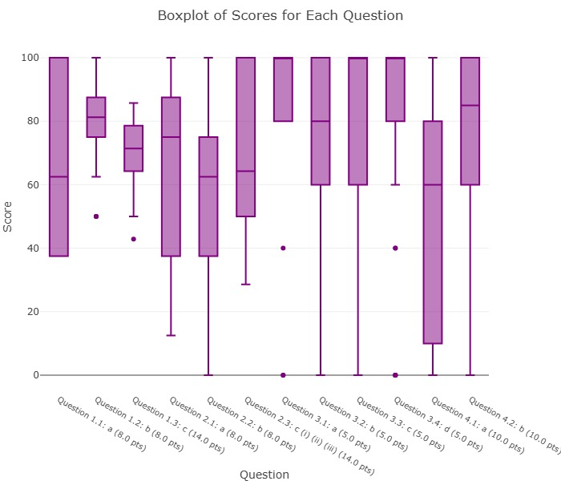

# Case Study: AI Feedback Generation with Knowledge, Understanding and Skill Tagging

**MSc Data Science Dissertation · Lougborough University**

I extended an existing Streamlit app that uses the OpenAI API to generate personlaised feedback. My main contribution was **question tagging by Knowledge, Understanding and Skill (KUS)**, so feedback explains *which kinds of ability* a student showed, not just how many marks they scored.

> This page summarises the project. The source code is held privately while I confirm publication with the university, and is **avaliable on request**.

---

## The problem

Assessment feedback is often limited to marks per question. That tells a student *where* they lost marks, but not *why*: missing knowledge, misunderstood concepts, or difficulty applying skills. Writing that kind of feedback by hand for a whole cohort takes lecturers a lot of time.

## Starting point

The app was originally built by previous students. It let lecturers upload assessment marks, explore cohort, student and question statistics, compare cohorts across years, and generate AI feedback for each student.

## My contributions

| Area | What I did |
|---|---|
| **KUS question tagging** | Added the ability to tag each question with the Knowledge, Understanding or Skill it tests, uploaded on the Home page for the GradeScope and "Other" assessment formats, which feed into summative assessment. |
| **Prompt design** | Redesigned the feedback prompts so the model weaves KUS insights into specific, natural feedback instead of generic comments. |
| **Student-vs-cohort KUS chart** | Added a chart to each student's feedback comparing their performance in each KUS category with the cohort. |
| **Evaluation and refinement** | Ran a student evaluation comparing the original and enhanced feedback, then refined the prompts based on the results. |
| **Maintenance** | Repaired inherited code that no longer ran, updated the app to current library versions, and moved the API key out of the code into an environment file. |

## How KUS tagging works

1. The lecturer uploads a tag file assigning each question to **Knowledge**, **Understanding** or **Skill**.
2. The app calculates each student's performance in each category, alongside the cohort average.
3. These results are passed into the prompt, so the feedback can say, for example, that a student is strong on knowledge-based questions but needs to practise applying skills.
4. The feedback PDF ends with a chart of the student's KUS profile against the cohort.

## Evaluation

In a small pilot study (**n = 7 students**), participants compared feedback from the original and enhanced systems.

**Result:** 4 preferred the original version and 3 preferred the enhanced version.

**What I learned:**
- Students valued the **detailed, question-by-question breakdown** in the original, which my first version had made more concise.
- The KUS insights were woven in so naturally that some students **didn't notice them**.
- Students were used to feedback organised around **marks per question**, not underlying abilities.

**Refinement:** I brought back the per-question detail, made the KUS tagging explicit in the feedback, and added the student-vs-cohort chart. The refined version has not yet been re-evaluated, and with seven participants these results are indicative rather than conclusive.

## Example output

An example feedback report is available in [example_feedback.pdf](example_feedback.pdf). All examples use test data, not real student data.

## Tech stack

Python · Streamlit · OpenAI API (`gpt-5.5`) · pandas · NumPy · scikit-learn · Plotly · fpdf2

## Future work

- Re-evaluate the refined prompts with a larger group of students
- Add objective quality measures, such as a marking rubric or lecturer review
- Extend KUS tagging to the app's other assessment formats

## Author

**Fairouz Nankya**, MSc Data Science, Loughborough University
[LinkedIn](https://www.linkedin.com/in/fairouz-nankya-b672aa26b) · [GitHub](https://github.com/fairouz-nankya)
